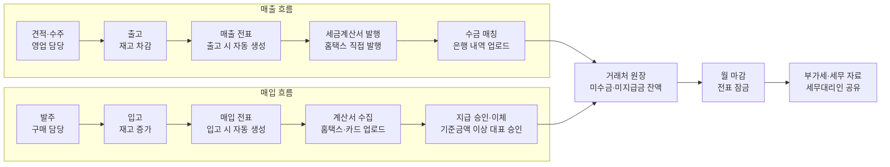
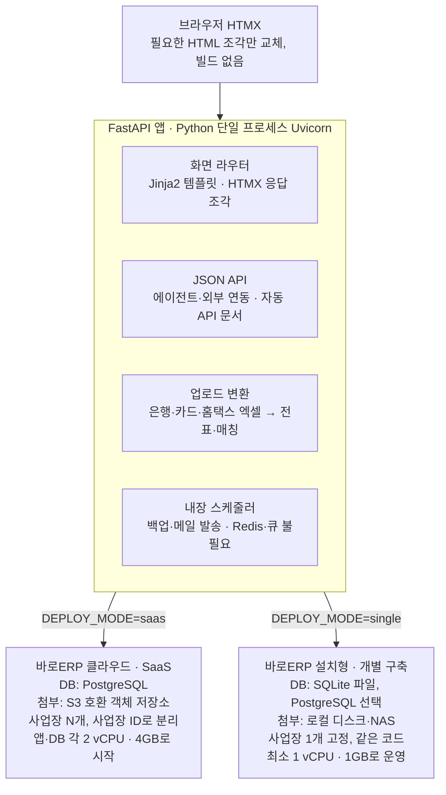
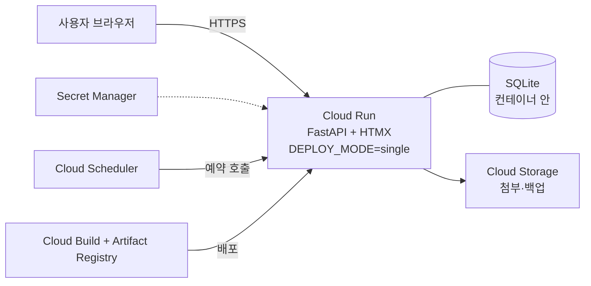

# 바로ERP 시스템 기획안: 소규모 기업 매입·매출·재고 관리

2026-10-30 · 작성: 박실장님

## 브랜드: 바로ERP

제품명은 **바로ERP**(영문 BaroERP)이며, ‘입력하면 바로 장부가 끝난다’는 속도와, 흩어진 장부를 ‘바로잡는다’는 정리의 두 뜻을 담습니다.

**슬로건**

- 메인: 입력하면 바로, 장부가 끝난다
- 보조: 매입·매출·재고, 바로 한 곳에서 / 작은 비용, 빠른 장부

**브랜드 약속**

| 약속 | 뜻 | 근거(기획안 내용) |
| --- | --- | --- |
| 바로 쓴다 | 설치·교육 부담 없이 시작 | 브라우저로 접속, 교육 1시간, 엑셀 일괄 등록 |
| 바로 본다 | 돈의 흐름과 할 일을 한 화면에서 | 대시보드, 미수금 에이징, 화면 응답 1초 이내 |
| 바로잡는다 | 흩어진 자료를 한 장부로 정리 | 은행·카드·홈택스 업로드 → 자동 매칭, 월 마감 잠금 |
| 바로 아낀다 | 값은 낮고 성능은 높게 | 외부 연계 무비용, 1 vCPU·1GB 운영, 월 3\~5만 원대 |

**제품 라인업**

| 제품명 | 형태 | 대상 |
| --- | --- | --- |
| 바로ERP 클라우드 | SaaS, 월 이용료 | 초기 비용 없이 바로 쓰려는 사업장 |
| 바로ERP 설치형 | 개별 구축, 1회 구축비 | 데이터를 사내에 두려는 사업장 |
| 바로ERP 에이전트 | 추가 옵션(11장) | 수작업을 더 줄이려는 사업장 |

**대상별 메시지**

- 대표: 이번 달 돈의 흐름을 바로 확인하세요.
- 경리·회계: 월 마감 3일을 하루로.
- 세무대리인: 마감된 자료를 바로 받아 보세요.

**표현·디자인 방향(제안)**

- 표기: ‘바로ERP’ 붙여 쓰기, 영문은 BaroERP
- 말투: 쉬운 말, 숫자로 말하기(‘3일 → 1일’), 회계 전문용어 최소화
- 로고: 한글 ‘바로’ 워드마크 + 체크(✓) 또는 앞으로 가는 화살표 모티브
- 색상: 신뢰를 주는 블루 계열을 주색으로, ‘바로’를 강조하는 밝은 포인트 색 1개
- 화면: 토스 스타일 참고 — 회색 배경 위 흰 둥근 카드, 크고 굵은 숫자, 파란 포인트(#3182F6), ‘~해요’체 안내 문구, 모바일 하단 탭(홈·영수증·지급 승인·전체)

**상표·도메인 확인**

‘바로’는 흔한 단어라 문자만으로는 등록이 어려울 수 있어, 로고와 함께 출원하는 방안을 검토합니다.

- [ ] KIPRIS에서 ‘바로ERP’·‘BaroERP’ 9류(소프트웨어)·42류(SaaS) 검색
- [ ] baroerp.com, baroerp.co.kr 등록 가능 여부 확인
- [ ] 유사 명칭의 회계·ERP 제품 유무 조사
- [ ] 로고 확정 후 문자+도형 결합상표 출원

## 1. 개요

임직원 50인 이하 사업자가 엑셀과 수기 장부 대신, 하나의 웹 시스템에서 매입·매출·수금·지급·부가세 자료를 관리하도록 하는 것이 목표입니다. 1차 오픈(MVP)은 착수 후 4개월, 제공 형태는 바로ERP 클라우드(SaaS, 월 이용료 사업장당 3\~5만 원대 가정)와 바로ERP 설치형(개별 구축, 1회 구축비) 두 가지이며, 둘 다 FastAPI + HTMX 한 코드로 최소 사양에서 운영합니다.

**문제 정의**

- 매출·매입 내역이 엑셀, 홈택스, 은행 앱, 영수증 사진에 흩어져 월말 마감에 며칠이 걸립니다.
- 미수금·미지급금을 거래처별로 바로 볼 수 없어 수금 누락과 이중 지급이 생깁니다.
- 부가세 신고 때마다 세무대리인에게 자료를 다시 정리해 보내야 합니다.
- 기존 ERP는 기능이 과하고 비싸며, 경리 1\~2명이 쓰기에 학습 부담이 큽니다.

**목표**

| 구분 | 목표치 |
| --- | --- |
| 월 마감 소요 시간 | 3일 → 1일 이내 |
| 홈택스·은행 자료 업로드 반영률 | 월 1회 엑셀 업로드로 95% 이상 |
| 미수금 연체 건수 | 도입 6개월 내 30% 감소 |
| 신규 사용자 교육 시간 | 1시간 이내 |

**대상 고객**: 도소매·제조·서비스업 법인 및 개인사업자, 연매출 1억\~100억 원, 회계 담당 1\~3명 규모.

## 2. 사용자와 권한

역할은 5개로 고정하고, 사업장마다 메뉴 단위로 조정할 수 있게 합니다. 금액 정보와 마감 해제는 대표·관리자만 다룹니다.

| 역할 | 주요 업무 | 조회 | 등록·수정 | 승인·마감 |
| --- | --- | --- | --- | --- |
| 대표(관리자) | 대시보드 확인, 지급 승인, 사용자 관리 | 전체 | 전체 | 전체 |
| 경리·회계 | 수금·지급 처리, 세금계산서, 월 마감 | 전체 | 전체 | 월 마감(해제는 대표) |
| 영업 | 견적·수주·출고, 영업기회·실적 관리, 담당 거래처 미수금(채권) 확인 | 매출·채권(본인 담당 거래처) | 매출 전표 | 없음 |
| 구매·자재 | 발주·입고, 재고 확인, 매입처 미지급금(채무) 확인, 납기·품질 평가 | 매입·재고·채무 | 매입 전표 | 없음 |
| 세무대리인(외부) | 부가세·장부 자료 다운로드 | 마감된 기간만 | 없음 | 없음 |

- 모든 등록·수정·삭제는 사용자·시각·변경 전후 값을 감사 로그로 남깁니다.
- 지급 승인 기준금액(예: 100만 원 이상)을 사업장이 설정합니다.

## 3. 핵심 기능

기능은 11개 모듈로 나누며, MVP에는 우선순위 ‘필수’ 6개를 넣습니다.

| 모듈 | 주요 기능 | 우선순위 |
| --- | --- | --- |
| 기준정보 | 거래처(사업자번호 진위·휴폐업 조회: 공공데이터 무료 API), 품목그룹(최대 3단계), 품목(코드 + 사용자 지정 식별코드)·단가, 계정과목, 엑셀 일괄 등록 | 필수 |
| 매출 관리 | 견적 → 수주 → 출고 → 매출 전표, 거래명세서 출력·이메일 발송, 반품·할인 | 필수 |
| 매입 관리 | 발주 → 입고(검수 결과 입력) → 매입 전표, 영수증 사진 첨부, 경비 지출 | 필수 |
| 수금·지급 | 은행 거래내역 엑셀 업로드 → 전표 자동 매칭, 부분 수금, 어음·카드·현금 구분 | 필수 |
| 채권·채무 | 거래처별 원장, 미수·미지급 잔액, 연체 일수(에이징), 독촉 메일 | 필수 |
| 세금계산서 | 발행 대상 목록 생성 → 홈택스에서 직접 발행 → 승인번호 업로드로 전표 대사, 매입 계산서는 홈택스 내역 업로드 | 필수 |
| 매출 거래처 관리 | 영업기회(파이프라인), 활동 기록, 목표 대비 실적 | 2차 |
| 매입 거래처 관리 | 납기 준수, 입고 품질, 단가 이력, 평가 등급 | 2차 |
| 재고 | 창고별 수량, 입·출고·폐기 이력, 가용·폐기 수량 구분, 폐기 손실 처리, 품목별 단위·용량 표시, 적정재고 알림, 월말 실사 | 2차 |
| 보고서 | 일·월별 매출·매입, 거래처·품목그룹·품목별 손익, 부가세 신고 보조자료, 엑셀·PDF 내보내기 | 2차 |
| 마감 | 월 마감 잠금, 마감 후 수정 차단, 세무대리인 자료 공유 | 2차 |

### 거래처 유형별 관리

거래처를 매출·매입·공통으로 구분하고, 구분에 따라 목적에 맞는 관리 화면을 보여줍니다. 매출 거래처는 ‘더 팔기’, 매입 거래처는 ‘안정적으로 사기’가 목적입니다.

| 구분 | 관리 항목 | 주요 지표 | 활용 |
| --- | --- | --- | --- |
| 매출 거래처 | 영업기회(발굴 → 제안 → 견적 → 협상 → 수주·실패, 예상 금액·확률·시기), 활동 기록(방문·통화·메일), 담당자·거래처별 매출 목표 | 수주율, 목표 대비 달성률, 파이프라인 금액(금액 × 확률), 평균 수금일 | 주간 영업 회의, 담당자 실적 평가, 여신한도 조정 |
| 매입 거래처 | 발주별 약속 납기 대비 실제 입고일, 입고 검수(합격·불량 수량, 사유), 반품·클레임, 단가 이력 | 납기 준수율, 불량률, 단가 변동률, 종합 평가 등급(A\~D) | 분기 평가, 대체 공급처 검토, 단가 협상 |

- 영업기회가 수주되면 견적·수주 전표로 이어져 실적에 자동 반영됩니다.
- 입고 전표에 검수 결과 칸을 두어, 별도 입력 없이 납기·품질 지표를 계산합니다.
- 평가 등급 가중치(예: 납기 40, 품질 40, 가격 20)는 사업장이 설정합니다.
- 매출·매입을 모두 하는 공통 거래처는 두 화면을 함께 쓰고, 원장에서 채권·채무를 상계해 봅니다.

## 4. 업무 흐름

한 번 입력한 거래는 다음 단계 전표를 자동으로 만들며, 매출과 매입은 거래처 원장에서 합쳐져 월 마감으로 이어집니다.

수금·지급이 끝난 거래만 원장에서 잔액이 0이 되고, 월 마감으로 잠긴 자료만 세무대리인에게 공유됩니다.

## 5. 데이터 모델

모든 거래는 ‘전표(헤더) + 전표 품목(라인)’ 구조로 저장하고, 수금·지급은 별도 테이블에서 전표와 N:M으로 연결합니다. 모든 테이블에 사업장 ID를 두어 한 시스템에서 여러 사업장을 분리합니다(SaaS 멀티테넌트). 개별 구축은 같은 구조에 사업장 1개만 두며, SQLite와 PostgreSQL 어느 쪽에서도 동일하게 동작하도록 DB 전용 기능을 쓰지 않습니다.

| 엔터티 | 주요 항목 | 관계 |
| --- | --- | --- |
| 사업장 | 사업자번호, 상호, 과세 유형, 결산월 | 사용자·거래처·전표의 상위 |
| 사용자 | 이름, 이메일, 역할, 담당 거래처 | 사업장 1 : N |
| 거래처 | 사업자번호, 구분(매출·매입·공통), 결제조건, 여신한도, 평가 등급 | 전표 1 : N |
| 품목그룹 | 코드(ID), 식별코드(유니크), 그룹명, 상위 그룹, 단계, 정렬 순서, 사용 여부, 품목 기본값 | 자기 참조(상위 1 : 하위 N), 품목 1 : N |
| 단위 | 코드, 단위명(리터·킬로그램·개·병·박스 등), 기호(L, kg, ea), 유형(개수·부피·무게·길이), 기준 단위 환산비(1L = 1,000mL), 소수점 자릿수 | 품목 1 : N |
| 품목 | 코드(ID, 시스템 자동 부여·변경 불가), 식별코드(사업장 내 유니크, 사용자 지정 형식), 품목명, 품목그룹, 규격, 재고 단위, 단위 용량(예: 1병 = 500mL), 거래 단위 환산, 매입·판매 단가, 과세·면세 | 품목그룹 N : 1, 단위 N : 1, 전표 품목 1 : N |
| 전표 | 구분(매출·매입), 일자, 공급가, 부가세, 상태, 마감 여부 | 전표 품목 1 : N, 세금계산서 1 : 0..1 |
| 전표 품목 | 품목, 수량, 단가, 금액, 창고, 약속 납기, 검수 결과(매입) | 재고 이력 생성 |
| 폐기 전표 | 일자, 품목, 수량, 창고, 사유(유통기한·파손·불량·기타), 상태(대기·승인·취소), 단가(이동평균), 손실 금액, 증빙 첨부, 승인자 | 재고 이력(폐기 출고) 생성, 폐기손실 분개 생성 |
| 세금계산서 | 승인번호, 발행일, 출처(홈택스 업로드) | 전표와 대사 |
| 수금·지급 | 일자, 금액, 수단, 계좌·카드 | 전표 N : M(배분 테이블) |
| 업로드 이력 | 파일명, 출처(은행·카드·홈택스), 변환 건수, 실패 행 | 생성한 전표·수금 1 : N |
| 영업기회 | 거래처, 단계, 예상 금액·확률·시기, 담당자, 활동 기록 | 매출 거래처 1 : N, 수주 전표 1 : 0..1 |
| 매입처 평가 | 기간, 납기 준수율, 불량률, 단가 변동률, 등급 | 매입 거래처 1 : N(분기별) |
| 감사 로그 | 사용자, 대상, 변경 전후 값, 시각 | 모든 테이블 |

**품목 코드와 식별코드**

코드는 시스템이 식별하는 ID이고, 식별코드는 사람이 보고 입력하는 내부 관리번호입니다. 전표·재고는 코드(ID)로 연결하므로, 식별코드를 바꿔도 과거 거래가 깨지지 않습니다.

| 항목 | 코드(ID) | 식별코드 |
| --- | --- | --- |
| 역할 | 시스템 내부 식별, 테이블 간 연결 | 화면 검색·입력, 출력물·바코드 표기 |
| 부여 방식 | 등록 시 자동 부여 | 사업장이 정한 형식으로 자동 채번 또는 직접 입력 |
| 유일성 | 전체 시스템에서 유일 | 사업장 안에서 유일(중복 저장 차단) |
| 변경 | 불가 | 가능(변경 이력은 감사 로그에 기록) |
| 엑셀 업로드 매칭 | 미사용 | 식별코드로 기존 품목 찾기 |

- 형식 설정: 접두어, 품목그룹, 연도, 일련번호 자릿수를 조합합니다. 예: 원자재 `RM-2026-0001`, 제품 `FG-A-001`.
- 품목그룹별로 다른 형식을 쓸 수 있고, 형식을 바꿔도 기존 식별코드는 그대로 유지합니다.
- 식별코드는 대소문자·앞뒤 공백을 정리해 비교하므로 `rm-2026-0001`과 `RM-2026-0001`은 중복으로 봅니다.

**품목그룹**

품목은 최대 3단계(대분류 > 중분류 > 소분류) 품목그룹 중 하나에 속하며, 그룹은 분류·기본값·집계의 단위가 됩니다. 예: 원자재 > 금속 > 스테인리스.

| 구분 | 규칙 |
| --- | --- |
| 구조 | 단계 수(1\~3)는 사업장이 설정, 품목은 최하위 그룹에만 소속 |
| 식별 | 품목과 같이 코드(ID) + 사용자 지정 식별코드(사업장 내 유니크) |
| 기본값 | 계정과목, 과세·면세, 단위, 식별코드 형식, 적정재고 기준을 그룹에 설정 → 품목 등록 시 자동 입력, 품목에서 변경 가능 |
| 집계 | 보고서·대시보드에서 그룹별 매출·매입·재고 합계, 상위 그룹은 하위 포함 |
| 일괄 작업 | 그룹 단위 단가 일괄 조정(%), 목록 필터, 엑셀 업로드 시 그룹 식별코드로 지정 |
| 변경·삭제 | 품목·하위 그룹이 있으면 삭제 대신 ‘사용 안 함’, 그룹 이동은 감사 로그에 기록 |
| 미분류 | 그룹을 정하지 않은 품목은 기본 ‘미분류’ 그룹에 속함 |

보고서는 품목의 현재 그룹 기준으로 집계하므로, 품목을 다른 그룹으로 옮기면 과거 실적도 새 그룹으로 재집계됩니다.

**단위와 용량**

품목마다 재고를 세는 단위와 그 단위 하나의 용량을 함께 관리합니다. 재고 현황에는 수량과 총 용량이 같이 표시됩니다. 예: 생수 500mL 120병 → '120병 · 60L'.

| 항목 | 내용 |
| --- | --- |
| 단위 관리 | 기본 단위(개, 병, 박스, mL, L, g, kg, m) 제공, 사업장에서 추가 가능. 유형별 기준 단위와 환산비 보유(1L = 1,000mL, 1kg = 1,000g) |
| 재고 단위 | 재고를 세는 단위(예: 병). 수량·재고 이력·실사는 모두 이 단위 기준 |
| 단위 용량 | 재고 단위 하나의 용량과 그 단위(예: 1병 = 500mL, 1포대 = 20kg). 용량이 없는 품목은 비워 둠 |
| 거래 단위 환산 | 매입은 박스, 판매는 병처럼 거래마다 다른 단위 사용 가능(예: 1박스 = 20병). 전표 입력 시 재고 단위로 자동 환산 |
| 기본 거래 단위 | 품목마다 매입·매출 기본 단위를 재고 단위나 거래 단위 중에서 지정(비우면 재고 단위). 전표에서 품목을 고르면 그 단위와 환산 단가가 채워지고, 줄마다 바꿀 수 있음 |
| 거래 단위 관리 | 기준정보 > 거래 단위 탭에서 품목별 환산과 매입·매출 기본 단위를 한눈에 조회(거래 단위·환산 유무·품목그룹으로 검색). 선택한 품목이나 검색 결과 전체에 "1박스 = 20(재고 단위)"를 한 번에 추가·변경하거나 지우고, 매입·매출 기본 단위로 함께 지정. 재고 단위와 같은 단위인 품목은 건너뛰고, 지운 단위가 기본 단위였으면 재고 단위로 되돌림. 환산을 바꿔도 이미 등록된 전표는 등록 시점 환산값 유지 |
| 소수 수량 | 재고 단위가 kg·L 같은 계량 단위이면 소수 수량 허용(예: 12.5kg), 자릿수는 단위별 설정 |
| 표시 | 재고 현황·품목 목록에 '수량 + 재고 단위'와 '총 용량'을 함께 표시, 큰 값은 상위 단위로 자동 변환(60,000mL → 60L), 그룹 합계는 같은 용량 유형끼리만 합산 |

**폐기 처리**

유통기한 경과, 파손, 품질 불량처럼 팔거나 쓸 수 없게 된 재고는 매출·매입이 아닌 '폐기 전표'로 처리합니다. 세금계산서와 부가세는 생기지 않고, 재고 수량은 줄이고 금액은 손실로 반영합니다.

| 항목 | 내용 |
| --- | --- |
| 등록·승인 | 담당자가 품목·수량·사유·증빙 사진을 등록하면 '폐기 대기' 상태로 격리, 관리자 승인 시 재고에서 차감 |
| 재고 수량 표시 | 재고 현황에 현재고, 폐기 대기(격리), 가용 재고(현재고 − 폐기 대기), 기간 폐기 누계를 컬럼으로 표시 |
| 손실 금액 | 폐기 수량 × 폐기 시점 재고 단가(이동평균) |
| 회계 처리 | 승인 시 자동 분개: (차) 재고자산폐기손실 / (대) 상품·제품·원재료. 정상 범위 폐기를 매출원가에 포함할지 사업장 설정으로 선택 |
| 취소 | 마감 전에는 승인 취소로 재고·분개 원복, 마감 후에는 역분개 전표로 처리 |
| 증빙 | 사진, 폐기 확인서, 폐기업체 영수증을 전표에 첨부해 손금 인정 근거로 보관 |
| 보고서 | 기간·품목·품목그룹·사유별 폐기 수량·손실 금액, 매출 대비 폐기율, 대시보드에 이번 달 폐기 손실 표시 |

월말 실사에서 장부보다 적게 나온 수량(감모)은 폐기와 구분해 '재고 조정'으로 기록하되, 같은 손실 계정 체계로 집계합니다. 손실 계정 분류와 손금 처리 기준은 도입 시 세무대리인과 확정합니다.

| 항목 | 구현 기준(S4) |
| --- | --- |
| 폐기 등록·승인 | 등록은 재고 메뉴 권한자(구매·자재 포함), 승인·승인 취소는 대표·경리. 등록자는 승인 대기 건을 직접 취소 가능. 가용 재고보다 많이 등록할 수 없음(음수 재고 허용 사업장 제외) |
| 이동평균 단가 | 품목별 전 창고 합산, 해당 일자까지의 입고 원가로 계산. 입고 원가가 없으면 품목 매입단가 사용 |
| 창고 이동 | 보내는 창고·받는 창고·이동일을 고르면 보내는 창고의 재고 목록(현재고·가용)이 나오고, 옮길 수량만 입력. 보내는 창고 −수량, 받는 창고 +수량의 단순 이동으로 원가·분개 없음(이동평균 단가 영향 없음). 가용 재고 이내만 이동, 취소는 대표·경리(마감 후에는 오늘 날짜로 반대 방향 이동) |
| 실사 조정 | 창고·실사일을 고르면 실사일 기준 장부 수량이 채워진 실사표 제공, 입력한 품목만 차이만큼 조정. 부족분은 (차) 재고자산감모손실 / (대) 상품, 초과분은 반대 |
| 증빙 | 사진(JPG·PNG·WEBP·HEIC)·PDF, 파일당 10MB. 설치형은 로컬 디스크, 데모는 Cloud Storage(S5), SaaS의 S3 호환 저장소는 다음 단계 |
| 계정과목 기본값 | 현금 101, 보통예금 103, 외상매출금 108, 부가세대급금 135, 상품 146, 외상매입금 251, 부가세예수금 255, 상품매출 401, 상품매출원가 451, 재고자산감모손실 958, 재고자산폐기손실 959. 코드·이름은 기준정보에서 변경 가능(자동 분개 계정은 끌 수 없음) |
| 전표 번호 | 매출 S-, 매입 P-, 폐기 D-, 창고 이동 T-, 재고 조정 A-, 수금 R-, 지급 W- + 일자 + 순번 4자리 |

**수금·지급과 세금계산서 대사**

| 항목 | 구현 기준(S4) |
| --- | --- |
| 배분 | 수금·지급을 거래처의 미결 전표에 배분(부분 수금 가능). 금액을 비우면 오래된 전표부터 자동 배분, 남는 금액은 선수금·선급금 |
| 잔액·연체 | 미수(미지급) 잔액 = 전표 합계 − 확정된 수금(지급) 합계. 연체 일수 = 오늘 − (전표 일자 + 거래처 결제조건 일수), 구간은 미도래·1\~30·31\~60·61\~90·90일 초과 |
| 지급 승인 | 기준금액 이상 지급은 대표가 아닌 사람이 등록하면 '승인 대기', 대표 승인 후 잔액 반영. 승인 대기 금액도 배분 한도에는 잡아 이중 지급을 막음 |
| 전표 보호 | 수금·지급이 배분된 전표는 취소 불가, 배분 금액보다 적게 수정 불가. 세금계산서와 대사된 전표는 거래처·금액 변경과 취소 불가(대사를 먼저 해제) |
| 홈택스 업로드 | 목록조회 엑셀(.xlsx)·CSV, '승인번호' 행을 머리글로 인식. 공급자·공급받는자 사업자번호로 매출·매입 자동 구분, 같은 승인번호는 한 번만 저장, 오류 행만 건너뛰고 업로드 이력에 남김 |
| 자동 대사 | ① 같은 사업자번호 거래처·같은 달·공급가액·세액이 같은 전표 1건(같은 날 우선) ② 없으면 그 달 미대사 전표 합계가 같을 때 월합계 발행으로 보고 모두 연결 ③ 나머지는 화면에서 전표를 골라 직접 대사(금액 일치 필수) |
| 발행 대상 | 사업자번호가 있는 거래처의 미대사 매출 전표, 발급 기한(공급한 달의 다음 달 10일) 표시. 홈택스 일괄발행 양식 맞춤은 S5 |
| 세무대리인 | 세금계산서 내역·부가세 합계만 조회, 마감된 달의 자료만 표시 |

## 6. 외부 연계(무비용) 및 법규 대응

외부 연계는 비용이 들지 않는 방식만 씁니다. 유료 중계 API 대신 무료 공공 API와 ‘기관 사이트에서 무료로 내려받은 엑셀 → 시스템 업로드’를 기본으로 하며, 업로드 후 전표 변환·매칭은 시스템이 자동으로 처리합니다.

| 연계 대상 | 용도 | 무비용 방식 | 사용자 작업 |
| --- | --- | --- | --- |
| 국세청 홈택스(매출) | 전자세금계산서 발행 | 시스템이 발행 대상·금액을 정리 → 홈택스에서 직접 발행(무료) → 발행 목록 엑셀 업로드로 승인번호 대사 | 월 수회 발행, 월 1회 업로드 |
| 국세청 홈택스(매입) | 매입 세금계산서·현금영수증·사업용 카드 내역 | 홈택스 조회 화면에서 엑셀 다운로드 → 업로드 시 매입 전표 자동 생성 | 월 1회 |
| 사업자 상태 조회 | 거래처 진위·휴폐업 확인 | 공공데이터포털 국세청 사업자등록정보 API(무료, 일일 호출 한도 내) | 없음(거래처 등록 시 자동) |
| 은행 계좌 | 입출금 → 수금·지급 매칭 | 인터넷뱅킹 거래내역 엑셀 다운로드 → 업로드, 은행별 양식 자동 인식 | 주 1회 권장 |
| 법인카드 | 카드 사용 → 경비·매입 전표 | 카드사 사이트 또는 홈택스 사업용 카드 내역 엑셀 업로드 | 월 1회 |
| 메일 | 거래명세서·독촉 안내 발송 | 회사 메일 계정 SMTP 연결(유료 알림톡 대신) | 최초 1회 설정 |
| 회계 프로그램 | 세무대리인 전달 | 더존·세무사랑 일반전표 업로드 양식 엑셀 내보내기 | 마감 후 1회 |

향후 수작업을 더 줄여야 하면 유료 중계 API(자동 수집·자동 발행)를 사업장별 선택 옵션으로 추가할 수 있도록, 업로드 모듈과 같은 데이터 형식으로 설계합니다.

**법규 대응**

- 전자세금계산서는 홈택스에서 직접 발행해 국세청 전송이 자동으로 이뤄지며, 시스템은 발행 대상 중 승인번호가 없는 건을 알려 발행 누락을 막습니다.
- 부가세 신고 기간(법인 분기, 개인 반기)에 맞춰 매출·매입처별 세금계산서 합계표를 제공합니다.
- 장부·증빙은 국세기본법상 5년 보관하며, 마감된 전표는 삭제할 수 없고 역분개(취소 전표)만 허용합니다.
- 거래처 담당자 연락처는 개인정보보호법에 따라 암호화하고 접근 기록을 남깁니다.

## 7. 화면 구성 및 대시보드

좌측 메뉴 10개와 첫 화면 대시보드로 구성하며, 모든 목록은 기간·거래처·상태 필터와 엑셀 내보내기를 기본으로 갖습니다.

**대시보드(대표·경리 기준)**

- 이번 달 매출·매입·매출이익 합계와 전월 대비 증감, 재고 폐기 손실
- 이번 주 수금 예정액·지급 예정액, 계좌 잔액
- 30일 초과 미수금 거래처 상위 5곳
- 처리 대기: 매칭되지 않은 입출금, 미발행 세금계산서, 승인 대기 지급
- 최근 12개월 매출·매입 추이 차트

**메뉴 구성**

| 메뉴 | 하위 화면 |
| --- | --- |
| 매출 | 견적·수주, 매출 전표, 거래명세서 |
| 매입 | 발주, 매입 전표, 경비·영수증 |
| 재고 | 재고 현황(현재고·폐기 대기·가용·총 용량), 입·출고 이력, 폐기 등록·승인, 창고 이동, 실사 조정 |
| 자금 | 수금·지급 등록(전표 배분), 입출금 내역, 지급 승인, 은행 내역 자동 매칭(13\~16주차) |
| 채권 | 매출 거래처 원장, 미수금 에이징, 독촉, 영업기회·실적 |
| 채무 | 매입 거래처 원장, 미지급금, 지급 예정, 매입처 평가 |
| 세금계산서 | 발행, 수집 내역, 부가세 합계표 |
| 보고서 | 기간별·거래처별·품목별 분석, 월 마감 |
| 기준정보 | 거래처, 품목·품목그룹, 단위, 거래 단위, 창고, 계정과목, 엑셀 일괄 등록 |
| 설정 | 사업장, 사용자·권한, 감사 로그, 연동 |

모바일은 대시보드 조회, 영수증 촬영 등록, 지급 승인 3가지만 제공합니다(반응형 웹).

## 8. 기술 구성 및 비기능 요구사항

하나의 코드베이스(FastAPI + HTMX)를 설정만 바꿔 SaaS(다중 사업장)와 개별 구축(단일 사업장) 두 형태로 배포합니다. 프론트엔드 빌드 없이 서버가 HTML을 만들기 때문에, 개별 구축은 1 vCPU·1GB 서버에서도 운영할 수 있는 것을 목표로 합니다.

화면·API·업로드 변환·스케줄러가 한 프로세스에 들어 있어 별도 프론트 서버, Redis, 메시지 큐가 필요 없고, 배포 형태는 환경 변수 하나로 고릅니다.

### 기본 기술 스택

| 영역 | 선택 | 이유 |
| --- | --- | --- |
| 웹 프레임워크 | FastAPI(Python 3.12) + Uvicorn | 가볍고 빠름, 자동 API 문서로 에이전트 연동에 유리 |
| 화면 | Jinja2 템플릿 + HTMX, 자체 CSS(디자인 토큰·공통 컴포넌트, Pretendard 폰트), 필요한 곳만 Alpine.js | Node 빌드 없음, 저사양 PC에서도 빠름, 토스 스타일 UI를 프레임워크 충돌 없이 구현 |
| 데이터 접근 | SQLAlchemy 2.0 + Alembic | SQLite·PostgreSQL 같은 코드로 지원, 스키마 변경 자동 적용 |
| 데이터베이스 | 개별 구축: SQLite(WAL 모드) 기본 / SaaS: PostgreSQL | 소규모는 DB 서버 불필요 |
| 백그라운드 작업 | 앱 내장 APScheduler, FastAPI BackgroundTasks | Redis·Celery 없이 변환·메일·백업 처리 |
| 엑셀·출력 | openpyxl(읽기 전용 모드), 거래명세서는 HTML 인쇄·PDF 저장 | 메모리 사용 최소화 |
| 인증 | 세션 쿠키 + 2단계 인증(간편 비밀번호 숫자 6자리), API는 토큰 | 별도 인증 서버·인증 앱 불필요 |
| 배포 | Docker 이미지 1개 + docker compose, Caddy로 HTTPS 자동 발급 / Windows용 설치형 패키지 검토 | SaaS·개별 구축 동일 절차 |

### 배포 형태

| 구분 | 바로ERP 클라우드(SaaS) | 바로ERP 설치형(개별 구축) |
| --- | --- | --- |
| 맞는 고객 | 초기 비용 없이 바로 쓰려는 사업장 | 데이터를 사내에 두려는 사업장, 맞춤 기능이 필요한 사업장 |
| 사업장 구성 | 다중 사업장, 사업장 ID로 분리 | 사업장 1개 고정(같은 코드) |
| 설치 위치 | 운영사 클라우드(국내 리전) | 고객 클라우드 VM, 사내 서버, 사무실 PC·NAS |
| DB | PostgreSQL | SQLite 기본, 사용자가 많으면 PostgreSQL |
| 업데이트 | 운영사 일괄 배포 | 이미지·설치 파일 교체, 기동 시 DB 변경 자동 적용 |
| 백업 | 운영사 일 1회 자동 | 내장 백업(DB 파일 + 첨부 압축) → 외장 디스크·NAS 복사 |
| 비용 구조 | 월 이용료 | 1회 구축비 + 연 유지보수(선택) |

### 최소 운영 사양(목표치, 성능 테스트로 확정)

| 구성 | 최소 | 권장 |
| --- | --- | --- |
| 개별 구축, 사용자 20명 이하 | 1 vCPU, 1GB RAM, 20GB 디스크, SQLite | 2 vCPU, 2GB RAM |
| 개별 구축, 사용자 50명 이하 | 2 vCPU, 2GB RAM, 40GB 디스크, SQLite | 2 vCPU, 4GB RAM, PostgreSQL |
| SaaS, 사업장 100곳 이하 | 앱 2 vCPU·4GB 1대 + DB 2 vCPU·4GB 1대 | 앱 2대 이중화 |
| 사용자 PC | 크롬·엣지 최신 버전, RAM 4GB | — |

**비기능 요구사항**

- 보안: HTTPS(Caddy 자동 인증서, 사내망은 자체 인증서), 비밀번호 해시, 2단계 인증(관리자 필수), 계좌 정보 암호화 저장, CSRF 방어
- 백업: SaaS는 DB 일 1회 전체 백업 + 시점 복구 30일, 개별 구축은 내장 백업 일 1회 + 복원 메뉴
- 성능: 최소 사양에서 화면 응답 1초 이내, 연 5만 전표 기준 목록 조회 2초 이내, 동시 사용자 50명
- 자원: 앱 프로세스 메모리 300MB 이하, 대용량 엑셀은 행 단위 스트리밍으로 처리
- 가용성: SaaS 월 99.5% 이상, 점검은 야간·주말
- 데이터 이전: 엑셀 양식으로 기존 거래처·품목·기초 잔액 일괄 입력, SaaS ↔ 개별 구축 간 데이터 내보내기·가져오기 지원

## 9. 추진 일정 및 예산

총 7개월 일정으로, 4개월차 말에 필수 6개 모듈로 MVP를 열고 파일럿을 거쳐 정식 출시합니다.

| 단계 | 기간 | 주요 내용 | 다음 단계 관문 |
| --- | --- | --- | --- |
| 1. 분석·설계 | 1개월차 | 요구사항 확정, 화면·DB 설계, 업로드 양식 수집 | 설계 승인: 화면·DB 확정 |
| 2. MVP 개발 | 2~4개월차 | 필수 6개 모듈, 엑셀 업로드·자동 매칭, 내부 테스트 | MVP 오픈: 필수 기능 테스트 통과 |
| 3. 파일럿 | 5개월차 | 사업장 5곳 실사용, 데이터 이전 지원, 개선 사항 반영 | 정식 출시: 파일럿 만족도 4.0/5 이상 |
| 4. 2차 확장 | 6~7개월차 | 재고·보고서·마감, 거래처 유형별 관리, 유료 전환 | — |

각 관문을 통과해야 다음 단계로 넘어가며, 은행·카드사·홈택스 엑셀 양식 수집이 1개월차에 끝나지 않으면 MVP 오픈이 밀립니다. 에이전트 기능은 정식 출시 후 별도 검토합니다(11장).

**투입 인력과 개략 예산(추정치, 견적 후 확정)**

| 항목 | 규모 | 개략 비용 |
| --- | --- | --- |
| 개발 인력 | PM 1, 풀스택(FastAPI·HTMX) 2, 디자인·QA 각 0.5명 × 7개월 | 약 1.2억\~1.6억 원 |
| 클라우드 인프라 | SaaS 개발·운영 환경(개별 구축은 고객 서버 사용) | 월 10만\~30만 원 |
| 외부 API | 공공데이터 API, SMTP 메일, 엑셀 업로드 | 0원(유료 중계 API는 선택 옵션) |
| 보안·법률 검토 | 모의해킹, 개인정보 처리방침, 약관 | 약 1,000만\~2,000만 원 |

위 금액은 일반적인 외주 단가를 기준으로 한 대략치이며, 내부 개발 여부와 업체 견적에 따라 달라집니다.

### 9-1. MVP 개발 일정: GCP 데모 우선

데모는 GCP의 Cloud Run(FastAPI 앱 + 컨테이너 안 SQLite)으로 12주 안에 먼저 열고, 데모 URL로 고객 반응을 확인한 뒤 설치형 패키지와 SaaS 다중 사업장 모드를 붙입니다. 데모는 설치형과 같은 사업장 1개 모드(`DEPLOY_MODE=single`)·SQLite로 동작하므로, 데모에서 만든 기능은 같은 코드로 설치형과 SaaS에서 그대로 씁니다.

**전제**

- 인력: PM 1, 개발 2(백엔드 중심 1, 화면·HTMX 중심 1), 디자인·QA 각 0.5명
- 진행: 2주 단위 스프린트 6회(S0\~S5), 스프린트마다 끝에 실행 가능한 화면 시연
- 데모 환경: Cloud Run(앱 + SQLite), GCP 무료 사용량 안에서 운영(아래 '데모 환경 구성(GCP)')
- SaaS 대비: 사업장 ID 컬럼과 `DEPLOY_MODE` 분기는 처음부터 넣고, 다중 사업장 가입·과금 화면은 만들지 않음

**MVP 범위**

| 구분 | 내용 |
| --- | --- |
| 포함 | 로그인·권한(5개 역할), 사업장 설정, 거래처, 품목그룹, 단위·용량, 품목(코드·식별코드), 창고, 매출·매입 전표, 재고 현황·이력, 폐기 처리·손실 분개, 수금·지급, 홈택스 세금계산서 엑셀 업로드, 대시보드, 백업·복원 |
| 제외(다음 단계) | 설치형 패키지(SQLite·docker compose), SaaS 다중 사업장·가입, 은행·카드 엑셀 자동 매칭, 영업기회·실적, 매입처 납기·품질 평가, 고급 보고서, 모바일 전용 기능, 에이전트 |

**스프린트 일정**

| 스프린트 | 기간 | 개발 내용 | 시연·산출물 |
| --- | --- | --- | --- |
| S0 착수·설계 | 1\~2주 | 요구사항·화면 흐름 확정, ERD·식별코드 규칙, FastAPI·HTMX 골격, Alembic, Docker 이미지, GCP 프로젝트·Cloud Run 배포 파이프라인, 테스트 자동화, 홈택스 엑셀 양식 수집 | 화면 설계서, ERD, 빈 앱 Cloud Run 배포·DB 연결 |
| S1 공통 기반 | 3\~4주 | 로그인·2단계 인증, 역할별 권한, 사업장 설정, 공통 레이아웃, 목록 필터·엑셀 내보내기, 감사 로그 | 로그인 후 메뉴·권한 확인 |
| S2 기준정보 | 5\~6주 | 거래처, 품목그룹(3단계), 단위·환산, 품목(식별코드·용량), 창고, 엑셀 일괄 등록 | 기준정보 엑셀 업로드 시연 |
| S3 거래 | 7\~8주 | 매출·매입 전표, 거래 단위 → 재고 단위 환산, 재고 이력 자동 생성, 거래명세서 인쇄, 마감 잠금 | 매입 → 재고 증가 → 매출 흐름 |
| S4 재고·자금 | 9\~10주 | 재고 현황(가용·폐기 대기·총 용량), 폐기 전표·승인·손실 분개, 실사 조정, 수금·지급, 미수·미지급 잔액, 세금계산서 엑셀 업로드·전표 매칭 | 폐기·수금·세금계산서 시연, 기능 동결 |
| S5 패키징·데모 | 11\~12주 | 대시보드, 배포 자동화(Cloud Build → Cloud Run), 내장 백업·복원, 데모 데이터, 통합 테스트, 최소 사양 성능 확인, 데모 리허설 | GCP 데모 v0.1(데모 URL) |

**마일스톤**

| 시점 | 마일스톤 | 확인 내용 |
| --- | --- | --- |
| 2주차 | 설계 확정 | 화면 흐름·ERD·MVP 범위 서명, 이후 범위 추가는 다음 단계로 이관 |
| 6주차 | 중간 점검 | 실제 거래처·품목 엑셀로 기준정보 등록 성공 |
| 10주차 | 기능 동결 | 데모 시나리오 전 과정이 화면에서 동작 |
| 12주차 | 데모 | 고객 또는 파일럿 후보 2\~3곳 대상 시연 |

**데모 시나리오(약 15분)**

1. 데모 URL에 접속해 사업장·관리자 초기 설정
2. 거래처·품목 엑셀 업로드(품목그룹·단위·식별코드 포함)
3. 매입 전표: 생수 500mL 10박스 입고 → 재고 '200병 · 100L' 확인
4. 매출 전표와 거래명세서 인쇄 → 재고 감소 확인
5. 파손 5병 폐기 등록·승인 → 폐기 수량·가용 재고·손실 금액 반영
6. 홈택스 세금계산서 엑셀 업로드 → 전표와 자동 매칭
7. 수금 등록 → 미수금 감소, 대시보드에서 이번 달 실적·폐기 손실 확인
8. 백업 파일로 복원해 데이터 보존 확인

**데모 완료 기준**

- 데모 시나리오를 오류 없이 2회 연속 수행
- Cloud Run 1 vCPU·512MiB에서 화면 응답 1초 이내(콜드 스타트 제외), 앱 메모리 300MB 이하
- 배포 스크립트 1회 실행으로 새 데모 환경을 30분 안에 구성
- 백업·복원 후 전표·재고 수치 일치

**데모 환경 구성(GCP)**

앱과 DB(SQLite)를 Cloud Run 컨테이너 하나에 두어 데모 기간에는 사실상 비용 없이 운영합니다. 데모 데이터는 어차피 매일 처음 상태로 돌아가므로 DB를 따로 두지 않고, 인스턴스가 뜰 때마다 데모 데이터를 새로 채웁니다(약 1초, 500KB). 아래 무료 한도는 작성 시점 기준이므로 구축 전에 GCP 정책을 다시 확인합니다.

| 구성 요소 | 설정 | 비용 |
| --- | --- | --- |
| 앱: Cloud Run | FastAPI 컨테이너, 1 vCPU·512MiB, 최소 인스턴스 0(시연 시간만 1), 최대 1, HTTPS 자동, 무료 등급 리전(us-west1·us-central1·us-east1) | 무료 한도 안(월 요청 200만 건, 18만 vCPU초) |
| DB: 컨테이너 안 SQLite | `/app/data/baroerp.db`(메모리 파일 시스템), 기동 시 `alembic upgrade head` → `python -m app.demo ensure`로 데모 데이터 채움 | 없음 |
| 첨부·백업 | Cloud Storage 버킷(같은 미국 리전): 증빙 첨부 2일, 수동 백업 7일 보관(버킷 수명 주기) | 5GB까지 무료 |
| 비밀값 | 세션 키·개인정보 암호화 키·예약 호출 토큰은 Secret Manager | 무료 한도 안 |
| 이미지·배포 | Artifact Registry + Cloud Build, main 브랜치 푸시 시 자동 배포 | 무료 한도 안 |
| 예약 작업 | Cloud Scheduler가 매일 04:00 `/tasks/demo-reset` 호출 | 3개까지 무료 |

데모 구성 때문에 달라지는 점:

- Cloud Run은 요청이 없으면 인스턴스가 꺼지므로 앱 내장 스케줄러(APScheduler)는 데모에서 끄고 Cloud Scheduler로 대신합니다. SQLite는 인스턴스마다 따로이므로 최대 인스턴스는 반드시 1로 둡니다.
- 컨테이너 디스크는 인스턴스가 꺼지면 사라집니다. 그래서 DB는 한동안 요청이 없어 인스턴스가 꺼진 뒤나 새로 배포한 뒤 처음 상태로 돌아가고, 방문자가 입력한 데이터는 남지 않습니다(데모 사이트 용도로는 오히려 맞음). 첨부 파일은 메모리를 아끼려고 Cloud Storage에 저장합니다(SaaS의 S3 호환 저장소와 같은 저장 인터페이스).
- 세션 쿠키에는 사용자 ID만 들어 있고 데모 계정은 항상 같은 순서로 만들어지므로, 인스턴스가 바뀌어도 둘러보던 방문자는 같은 계정으로 이어서 씁니다.
- 시연에서 가상 사업자번호를 쓸 수 있도록 `DEMO_MODE=true`로 두면 사업자번호는 10자리 숫자인지만 확인하고 검증번호 확인은 생략합니다.
- 콜드 스타트(수 초)와 시연 중 초기화를 피하려면 시연 시간에만 최소 인스턴스를 1로 올립니다.
- 무료 등급 리전이 미국이라 한국에서는 요청마다 약 0.1~0.2초가 더 걸립니다. 체감이 부족하면 서울 리전(asia-northeast3)으로 옮깁니다(Cloud Run은 무료 한도가 같고, 버킷·Artifact Registry 저장 비용이 조금 생깁니다).
- 과금 주의: 최소 인스턴스 1을 켜 둔 채 두기, 월 1GB를 넘는 외부 전송은 요금이 붙습니다. 결제 예산 알림을 월 1만 원으로 설정합니다.
- 고객 데이터를 남겨야 하는 파일럿은 데모가 아니라 설치형(docker compose + SQLite 파일, 디스크 유지)으로 엽니다.

**S5 구현 기준**

| 항목 | 구현 기준(S5) |
| --- | --- |
| 내장 백업 | DB 종류와 무관한 zip 1개: 테이블별 JSON + 증빙 첨부 + 정보 파일(앱·DB 버전, 테이블별 행 수, 암호화 키 확인값). 개인정보 컬럼은 암호문 그대로 담음. 설치형은 내장 스케줄러로 매일 03:00(Cloud Run에서 쓸 때는 Cloud Scheduler가 `/tasks/backup`(토큰 인증) 호출, 데모는 매일 초기화되므로 자동 백업 없음). 최근 7개 보관(`BACKUP_KEEP`) |
| 파비콘 | 파란 둥근 사각형(#3182F6) 위 흰 체크(✓): 브랜드 '바로잡는다'·토스 파랑. `static/img/favicon.svg`(기본), `favicon.ico`(16·32·48), `apple-touch-icon.png`(180), `icon-192/512.png`(웹 앱 매니페스트). `/favicon.ico`·`/apple-touch-icon.png`은 사이트 루트에서도 제공 |
| 데모 사이트 | `DEMO_MODE=true`일 때만: 첫 화면은 제품 소개(`/intro`: 고민 → 업무 흐름 → 기능 → 역할별 화면 → 체험 → 데모 계정 → 도입 방법·요금 → FAQ). 역할별 버튼을 누르면 로그인 없이 그 계정으로 해당 화면에 들어감(`/demo/enter/<역할>`, 같은 사이트 주소로만 이동). 데모 계정: 대표 박사장 demo1@example.com(간편 비밀번호 142536), 영업 김과장 demo2, 구매 장대리 demo3, 관리(경리·회계) 강부장 demo4, 비밀번호 모두 12345678. 앱 화면 위 데모 안내 줄(현재 역할·다른 역할로 바꾸기), 로그인 화면 '바로 들어가기'. 공용 계정 보호: 비밀번호·간편 비밀번호 변경, 사용자 수정, 메뉴 권한, 백업 복원 차단. 매일 04:00 처음 상태로(`python -m app.demo reset`, Cloud Scheduler `/tasks/demo-reset`). 초기 데이터: 3개월 거래(매입은 구매, 매출은 영업, 정산은 관리가 등록), 대표 승인 대기 지급·폐기 1건씩, 지난달 전표에 맞춘 홈택스 세금계산서 샘플 내려받기. 도입 문의는 문의 게시판(https://jwp-system.duckdns.org/contact?type=erp, 새 탭)으로 연결 |
| 거래처 상황판 | 메뉴 '거래처 상황판'(채무 다음). 목록: 이번 달 거래가 있거나 잔액이 남은 거래처의 이번 달 매출·매입(공급가), 미수금·미지급금, 30일 넘은 연체(이번 달 거래 많은 순, 거래처명·사업자번호 검색). 거래처를 누르면 홈 화면과 같은 구성의 상황판: 이번 달 매출·매입(지난달 같은 기간 대비), 미수금·미지급금과 연체, 처리할 일(이번 주 수금·지급 예정, 승인 대기 지급, 세금계산서 발급 대상·미대사), 최근 6개월 월별 거래, 최근 3개월 많이 거래한 품목, 최근 거래. 채권·채무 역할 분리에 따라 매출·채권 메뉴가 있으면 매출 쪽, 매입·채무 메뉴가 있으면 매입 쪽만 보이고(영업은 매출 거래처만), 권한 없는 메뉴로는 링크하지 않음. 기본 권한: 대표·경리·영업·구매 |
| 2단계 인증 | 인증 앱(QR) 대신 대표가 직접 정한 간편 비밀번호(숫자 6자리). 대표는 첫 로그인(초기 설정 직후)에 등록해야 다른 화면을 쓸 수 있고, 로그인과 승인(지급 승인·폐기 승인) 때 입력. 같은 숫자 반복·연속 숫자 금지, 해시(scrypt)로 저장, 5번 연속 틀리면 15분 잠금. 바꿀 때는 지금 번호 확인, 잊으면 다른 대표가 설정 > 사용자에서 초기화하거나, 대표가 한 명뿐이면 서버 명령 `python -m app.manage reset-pin --email`으로 초기화(다음 접속 때 다시 등록). GCP 데모는 `/tasks/demo-reset`으로 처음 상태로 되돌림. 다른 역할은 선택 등록(등록하면 로그인·승인 때 입력) |
| 복원 | 설정 > 백업·복원(대표만, SaaS 모드에서는 숨김). 보관 중인 백업이나 올린 파일을 골라 비밀번호를 다시 입력하면 복원. 파일·버전·암호화 키를 먼저 확인하고, 복원 직전 상태를 자동 백업한 뒤 한 트랜잭션으로 모든 테이블을 바꿈(실패 시 원상태). 끝나면 다시 로그인 |
| 저장소 | 증빙·백업 공통 인터페이스. 설치형은 로컬 디스크(`STORAGE_LOCAL_DIR`, `BACKUP_LOCAL_DIR`), 데모는 Cloud Storage 버킷의 `attachments/`·`backups/`(Cloud Run 서비스 계정 토큰, 별도 라이브러리 없음) |
| 데모 데이터 | `python -m app.demo files`: 시연용 거래처·품목 엑셀과 시나리오 매출·매입 전표에 맞춘 홈택스 세금계산서 엑셀. `python -m app.demo seed`: 빈 DB에 데모 사업장 + 최근 3개월 매입·매출·수금·지급·폐기 이력(지난달 이전 마감). `python -m app.demo ensure`: `DEMO_MODE=true`이고 DB가 비어 있을 때만 seed(컨테이너 기동 시 실행, 설치형에서는 아무것도 하지 않음) |
| 시연 금액 | 매입 맑은샘물 생수 500mL 10박스 × 6,000원(재고 200병 · 100L), 매출 행복마트 100병 × 600원, 파손 5병 폐기(손실 1,500원), 행복마트 66,000원 수금. 사업장 사업자번호 123-45-67815 |
| 통합 테스트 | 데모 시나리오 1\~8번을 화면 요청으로 따라가는 테스트(초기 설정·2단계 인증 → 엑셀 업로드 → 입고 → 판매·명세서 → 폐기 승인 → 세금계산서 자동 대사 → 수금·대시보드 → 백업·복원 후 전표·재고 수치 일치) |
| 성능 확인 | `scripts/perf_check.py`: 데모 이력을 채운 뒤 주요 화면 16개의 서버 처리 시간과 메모리 측정. 개발 PC·SQLite 기준 12개월(전표 600여 건)에서 화면당 최대 0.13초, 메모리 122MB. Cloud Run 실측은 배포 후 |
| 배포 자동화 | `deploy/gcp/setup.sh` 1회 실행으로 Artifact Registry·버킷·비밀값·Cloud Run(1 vCPU·512MiB, 최대 1, SQLite)·Cloud Scheduler 구성, 첫 기동 때 데모 데이터 자동 생성. 이후 배포는 `cloudbuild.yaml`(이미지 빌드 → Cloud Run 갱신, 새 인스턴스는 데모 데이터로 처음 상태), main 푸시 트리거는 콘솔에서 저장소 연결 |

데모 후 13\~16주차에 SaaS 다중 사업장·가입, 설치형 패키지(SQLite), 은행·카드 업로드를 붙여 4개월차 말 MVP 관문으로 이어갑니다. 일정이 밀리면 S4의 실사 조정과 S5의 대시보드 일부를 먼저 미루고, 데모 시나리오 3\~5번(입고·판매·폐기)은 반드시 지킵니다.

## 10. 기대 효과, KPI, 리스크

가장 큰 효과는 월 마감 시간 단축과 미수금 가시화이며, 가장 큰 리스크는 업로드 양식 변경과 초기 데이터 이전입니다.

**KPI(도입 6개월 후 측정)**

| 지표 | 측정 방법 | 목표 |
| --- | --- | --- |
| 월 마감 소요일 | 마감 시작\~잠금 시각 | 1일 이내 |
| 자동 매칭률 | 자동 매칭된 입출금 ÷ 전체 | 70% 이상 |
| 30일 초과 미수금 | 에이징 보고서 잔액 | 도입 전 대비 30% 감소 |
| 주간 활성 사용자 | 주 1회 이상 로그인 사용자 ÷ 등록 사용자 | 80% 이상 |
| 유료 유지율 | 6개월 후 유료 사업장 ÷ 전환 사업장 | 85% 이상 |

**리스크와 대응**

| 리스크 | 영향 | 대응 |
| --- | --- | --- |
| 은행·카드사·홈택스 엑셀 양식 변경 | 업로드 변환 실패 | 양식별 변환 규칙을 설정으로 분리, 실패 행은 수동 열 매핑 화면 제공 |
| 기존 엑셀 데이터 품질 불량 | 기초 잔액 불일치 | 검증 규칙이 있는 업로드 양식, 이전 대행 서비스 |
| 세법·양식 개정 | 신고 자료 오류 | 세무사 자문, 분기별 양식 점검 |
| 사용자 적응 실패 | 엑셀로 복귀 | 온보딩 체크리스트, 1시간 교육 영상, 첫 달 전담 지원 |
| 보안 사고 | 금융·거래처 정보 유출 | 암호화, 2단계 인증, 연 1회 모의해킹 |

## 11. 에이전트 기반 기능 확장(검토)

핵심 시스템은 AI 없이 동작하도록 만들고, 정식 출시 후 실제 수작업이 많이 남는 업무에만 에이전트를 추가 개발합니다. 에이전트는 초안·제안만 만들고, 전표 확정·발송·지급은 항상 사람이 승인합니다.

| 후보 에이전트 | 하는 일 | 기대 효과 | 도입 기준 |
| --- | --- | --- | --- |
| 업로드 정리 | 처음 보는 엑셀 양식의 열을 판별해 매핑 규칙 제안, 입금자명으로 거래처 추정 | 변환 실패·미매칭 건 감소 | 자동 매칭률이 70% 미만일 때 |
| 증빙 판독 | 영수증·거래명세서 사진에서 거래처·금액·품목 추출 → 매입 전표 초안 | 경비 입력 시간 단축 | 월 증빙 100건 이상 사업장 |
| 채권 관리 | 연체 거래처별 독촉 메일 초안, 수금 예상일 예측 | 연체 미수금 감소 | 30일 초과 미수금이 줄지 않을 때 |
| 영업 지원 | 영업기회별 다음 활동 제안, 주간 실적 요약 작성 | 영업 회의 준비 시간 단축 | 영업기회 기능 사용 안착 후 |
| 구매 지원 | 납기 지연·불량 징후 감지, 대체 공급처·단가 비교 요약 | 공급 차질 조기 대응 | 매입처 평가 데이터 2분기 누적 후 |
| 마감 점검 | 월 마감 전 누락 계산서, 중복 전표, 이상 금액 점검 목록 작성 | 마감 오류 감소 | 마감 후 수정 요청이 월 5건 이상일 때 |

- 비용: 에이전트는 LLM 사용료가 드는 유일한 영역이므로, 사업장별 월 사용 한도를 두거나 자체 서버의 오픈소스 모델로 비용을 낮추는 방안을 함께 비교합니다.
- 구조: 에이전트는 시스템 REST API를 사용자 권한 그대로 호출하고, 모든 제안·실행을 감사 로그에 남깁니다.
- 절차: 에이전트 1개씩 파일럿 사업장에서 1개월 시험 → 절감 시간이 비용보다 크면 정식 추가합니다.
